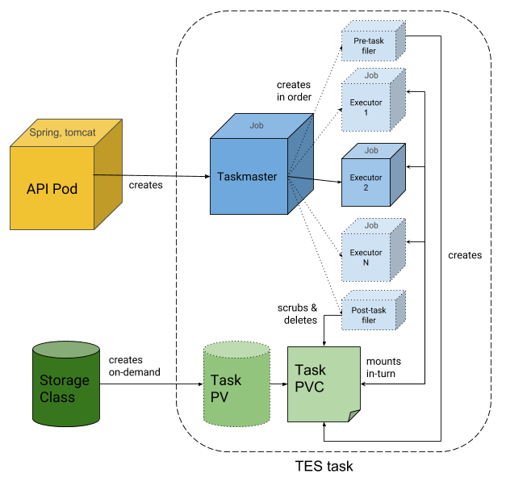

# Architecture

TESK runs each [TES](tesintro.md) task as Kubernetes jobs in one namespace.
It has three components, each in its own repository:

| Component | Repository | Runs as |
| --- | --- | --- |
| API | [tesk-api](https://github.com/elixir-cloud-aai/tesk-api) | A Deployment (`tesk-api`), the only long-running pod. |
| Taskmaster | [tesk-core](https://github.com/elixir-cloud-aai/tesk-core) | A job per task, created by the API. |
| Filer | [tesk-core](https://github.com/elixir-cloud-aai/tesk-core) | Jobs of a task, created by its taskmaster: one for the inputs, one for the outputs. |

This repository holds the Helm chart that deploys the API, with the
permissions that the API and the taskmasters need, and the documentation of
all three; the docs of tesk-api and tesk-core are pulled from their
repositories (see [Development](development.md#docs-of-tesk-api-and-tesk-core)).

## Life of a task

1. A client sends a task to the API (`POST /tasks`). The API validates it,
   and creates a **taskmaster** job for it, with the task (inputs, outputs,
   volumes, executors) as the job's input.
2. If the task has inputs, outputs or volumes, the taskmaster creates a
   persistent volume claim (**PVC**) as the task's scratch space, of the
   task's disk size, with the default storage class (or `storageClass`).
   Tasks without them get no PVC and no filers.
3. It runs the **filer** to download the inputs (HTTP(S), FTP, S3 or a
   shared file system) into the PVC, at the paths of the task.
4. It runs the **executors** one after the other, each as a job with the
   PVC mounted at the task's paths and volumes, with the CPU and memory of
   the task as requests and limits. If an executor fails, the task ends with
   `EXECUTOR_ERROR`, and later executors don't run.
5. It runs the filer again to upload the outputs, deletes the PVC and ends.

Each task has its own taskmaster and executors, and, with inputs, outputs
or volumes, its own PVC and filers; the API is the
only pod shared by all tasks. The API reads the state of a task (`GET
/tasks/{id}`) from its jobs and pods, and cancels it (`POST
/tasks/{id}:cancel`) by marking its taskmaster, which stops and deletes the
task's jobs.

The taskmasters use the service account `taskmaster`, which the API uses
too. Its role in the namespace allows creating, reading, changing and
deleting jobs; creating, reading and deleting PVCs and ConfigMaps; listing
and patching pods and reading their logs and status. Pods are created by the
jobs, not directly.

## Storage

The task's PVC holds its inputs, outputs and working files while it runs,
and is deleted afterwards. To exchange files with the outside, the filer
supports HTTP(S), FTP (with credentials of one account, or a `.netrc` file),
S3, and `file://` paths on a PVC shared with a workflow engine (see
[Storage backends](deployment.md#storage-backends)).
