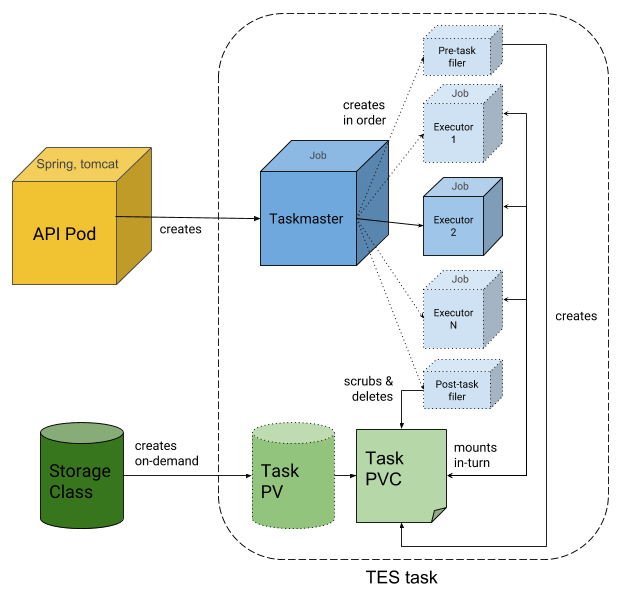

# TESK

TESK is an implementation of the [GA4GH Task Execution Service
(TES)](https://github.com/ga4gh/task-execution-schemas) API on
[Kubernetes](https://kubernetes.io/). Each TES task runs as Kubernetes jobs,
with the inputs and outputs staged in a temporary volume.

TESK is made of three repositories:

- [TESK](https://github.com/elixir-cloud-aai/TESK): the Helm chart that
  deploys TESK, and this documentation.
- [tesk-api](https://github.com/elixir-cloud-aai/tesk-api): the service that
  implements the TES API and turns tasks into Kubernetes jobs.
- [tesk-core](https://github.com/elixir-cloud-aai/tesk-core): the taskmaster,
  which runs the jobs of a task, and the filer, which stages its inputs and
  outputs.

## Architecture

The API (tesk-api) is the only long-running component: it accepts TES
requests, validates them and creates a taskmaster job for each task. The
taskmaster creates a persistent volume claim (PVC) as scratch space, runs the
filer to download the inputs into it, runs the executors one after the other
with the PVC mounted, and runs the filer again to upload the outputs. Then it
deletes the PVC. Each task has its own taskmaster, PVC and executor pods.

## Contents

- [Introduction to TES](tesintro.md): what a TES task looks like.
- [Deployment](deployment.md): install TESK with its Helm chart, expose it,
  and set up storage and authentication.
- [Integration with WES](integrated_wes_tes.md): TESK next to a workflow
  engine in the same cluster.
- [Local FTP server](local_ftp.md): exchange files through an FTP server on
  the host.
- [tesk-api](tesk-api/index.md) and [tesk-core](tesk-core/index.md): the docs
  of these components, from their repositories.
- [Development](development.md): development setup, checks and the
  documentation.

## License

This project is covered by the [Apache License
2.0](https://www.apache.org/licenses/LICENSE-2.0) also [shipped with this
repository](https://github.com/elixir-cloud-aai/TESK/blob/dev/LICENSE).

## Contact

The project is a collaborative effort under the umbrella of [ELIXIR
On-Cloud](https://elixir-on.cloud/). Follow the link to get in touch with us
via chat or email. Please mention the name of this service for any inquiry,
proposal, question etc.
